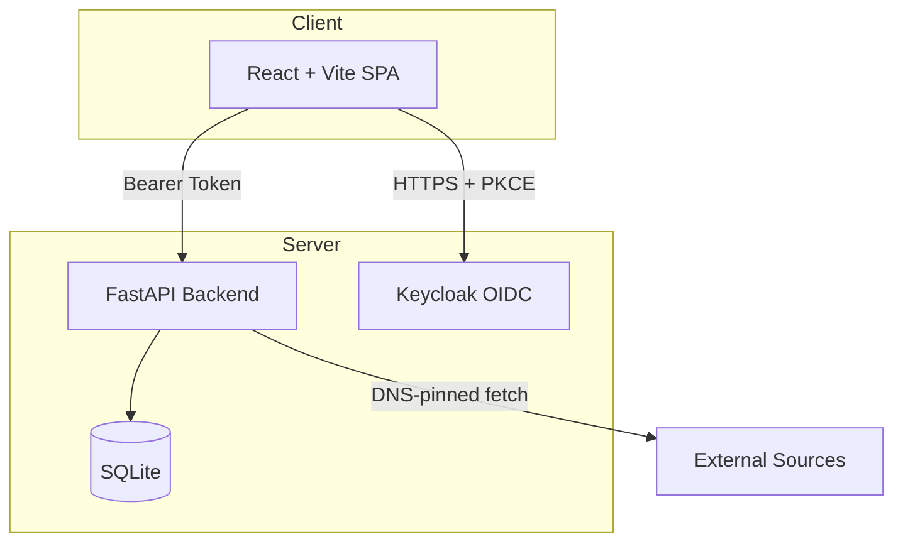

# Lumen Forge — Ryan Vo

> Work in progress. This checkpoint may be incomplete or fail tests. See PLAN.md and STATUS.md before use.


**Ryan Vo | AI & Machine Learning**

Lumen Forge is a video source management platform for AI/ML developers. It provides secure source ingestion with SSRF protection, mobile-optimized playback controls, and AI-assisted content discovery workflows.

## Problem

AI/ML developers working with video datasets need a reliable way to:
- Ingest and validate video sources from untrusted URLs without exposing internal infrastructure (SSRF via DNS rebinding)
- Play streams on mobile devices with usable controls that don't vanish after 3 seconds
- Browse and search content across multiple sources with correct poster aspect ratios

## AI/ML Approach

- **SSRF Protection**: DNS-pinned fetch with IP validation prevents DNS rebinding attacks (addresses LibreTV #941)
- **Mobile Playback**: Touch-optimized controls that persist on mobile, matching desktop hover behavior (addresses LibreTV #937)
- **Poster Display**: Native aspect ratio preservation for both landscape and portrait thumbnails (addresses LibreTV #942)

## Features

- **Source Management**: CRUD for video sources with connectivity validation
- **Secure Fetching**: DNS-pinned HTTP client prevents SSRF via DNS rebinding
- **Video Playback**: HLS/DASH support with mobile-friendly controls
- **Search & Browse**: Multi-source search with category browsing
- **Authentication**: OIDC/Keycloak with SPA PKCE flow
- **Docker Deployment**: Complete stack with persistent volumes

## Quick Start

### Prerequisites
- Docker 24+ and Docker Compose v2
- Node 24 (for local frontend dev)
- Python 3.12 (for local backend dev)

### Development

```bash
# Backend
cd backend
python -m venv .venv
.venv/bin/pip install -r requirements.txt
.venv/bin/uvicorn app.main:app --reload --port 8000

# Frontend (separate terminal)
cd frontend
npm install
npm run dev
```

### Docker Compose (Full Stack)

```bash
cp .env.example .env
# Edit .env with your values
docker compose up -d
# Frontend: http://localhost:5173
# Backend API: http://localhost:8000/api
# Keycloak: http://localhost:8080 (admin/admin)
```

## Testing

```bash
# Backend tests
cd backend
.venv/bin/pytest

# Frontend tests
cd frontend
npm test
```

## Architecture



## API Endpoints

| Method | Path | Description |
|--------|------|-------------|
| GET | /api/health | Health check |
| GET | /api/sources | List sources (paginated) |
| POST | /api/sources | Create source |
| GET | /api/sources/{id} | Get source |
| PUT | /api/sources/{id} | Update source |
| DELETE | /api/sources/{id} | Delete source |
| POST | /api/sources/{id}/test | Test source connectivity |

## Security Limitations

- SQLite is for development; production should use PostgreSQL
- Demo mode binds to localhost only; refuses to start in production without explicit config
- LLM API keys are server-side only; never exposed to client
- SSRF protection covers DNS rebinding but not all TOCTOU classes
- Keycloak realm import is for development; production needs proper realm management

## Provider Configuration

| Provider | Env Var | Description |
|----------|---------|-------------|
| OpenAI-compatible | LLM_API_KEY, LLM_BASE_URL, LLM_MODEL | OpenAI, LiteLLM, OpenRouter, Ollama |
| Anthropic | LLM_API_KEY, LLM_MODEL | Anthropic Messages API |
| Gemini | LLM_API_KEY, LLM_MODEL | Google Gemini generateContent |

## SSO/SAML Setup

Keycloak supports upstream SAML IdPs through identity brokering:
1. Configure SAML IdP in Keycloak Admin Console → Identity Providers
2. Map SAML attributes to realm roles (viewer/operator/admin)
3. Update `OIDC_ISSUER` to your production Keycloak realm

## License

MIT Copyright Ryan Vo <ryandtvo@gmail.com>